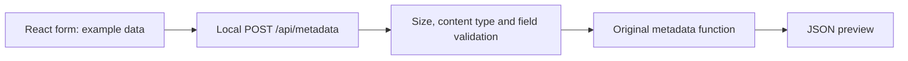

# FisiGames · Preparing metadata before a stream

## Contexto

El entorno local de FisiGames contiene un panel HTML, un puente Node.js para comunicación local, integración con OBS mediante Lua y utilidades PowerShell para preparar la operación de TikTok LIVE Studio. El puente operativo lee su autorización desde un archivo local; ese archivo y el puente completo no se publican aquí.

## Selección pública

[`prepare-metadata.cjs`](../src/fisigames/prepare-metadata.cjs) procede del módulo local que prepara los datos de TikTok. Es una función de transformación: no realiza peticiones, no abre aplicaciones y no emite en directo.

1. Exige que TikTok esté entre los destinos.
2. Recorta y valida juego y título.
3. Extrae hashtags Unicode.
4. Elimina duplicados sin distinguir mayúsculas.
5. Evita repetir hashtags que ya están en el título.
6. Devuelve un objeto estructurado sin modificar el borrador.

## Flujo de la demo

La API y el formulario se crearon para este portafolio. Añaden validación de tipos y tamaños alrededor de la función original. No incluyen autenticación productiva ni controles de publicación. Solo escuchan en loopback y no guardan datos.

## Pruebas

`npm test` comprueba campos vacíos, destino incorrecto, duplicados, Unicode y ausencia de mutación. La prueba HTTP inicia una instancia local en puerto efímero y verifica respuestas a JSON inválido, origen incorrecto, método incorrecto, payload excesivo y datos válidos. No se necesitan cuentas, claves ni aplicaciones de streaming.

## Límites

- Los resultados de las pruebas corresponden a la demo. No prueban estabilidad de OBS o TikTok LIVE Studio en una emisión real.
- Las reglas publicadas de hashtags son las del módulo existente, no una afirmación sobre los límites actuales de TikTok.
- La API de demo es una adaptación nueva del patrón local; no se presenta como el backend de producción.
- Las automatizaciones de escritorio dependen del entorno y deben verificarse en la aplicación real antes de usarse.
- La carpeta local también contiene una dependencia MCP de terceros. No se incluye ni se atribuye como creación propia.

## English summary

The source excerpt is a pure Node.js metadata preparation function from FisiGames. A new, isolated React/HTTP demo makes it reviewable end to end. It demonstrates deterministic validation and Unicode-aware hashtag normalization while keeping account access, desktop control and live broadcasting outside the public repository.
