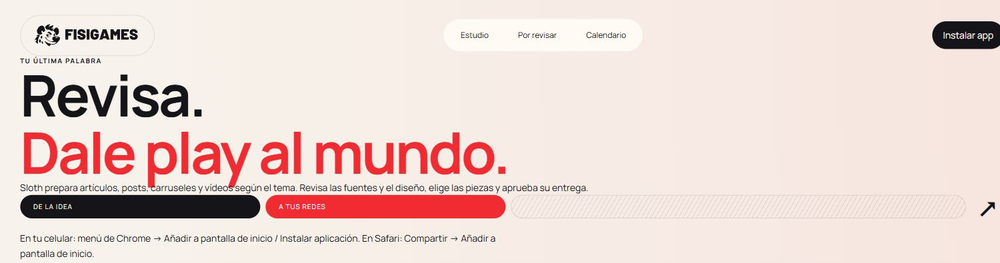

# FisiGames Studio · personalización sobre Postiz

## Problema y aporte

Adaptar una herramienta de publicación a la identidad y al flujo editorial de FisiGames. El trabajo presentado es la personalización de la interfaz y la experiencia de revisión alrededor de una plataforma existente.

**Postiz es un proyecto de terceros.** No presento su programador, sus integraciones sociales ni su plataforma base como desarrollo propio. Referencia: [Postiz, repositorio original](https://github.com/gitroomhq/postiz-app). El código original y sus licencias no se redistribuyen aquí.

## Captura real

Captura del 19 de noviembre de 2026, recortada al encabezado. No contiene publicaciones pendientes, nombres de clientes, credenciales ni configuración. Es una interfaz existente, no una maqueta del portafolio.

## Qué se pudo observar

- Identidad visual de FisiGames y navegación entre Estudio, Por revisar y Calendario.
- Pantalla de revisión con piezas editoriales: artículo, post y carrusel.
- Fuentes y créditos junto al contenido que se revisa.
- Estados separados por red social y horarios expresados en Ecuador.
- Distinción visible entre entrega al programador y publicación por canal.

## Decisiones de experiencia

La revisión humana debe ser comprensible: qué pieza se está mirando, de dónde proviene y cuál es su estado. La documentación distingue la personalización de esa experiencia de las capacidades del producto base.

## Verificación y límites

La pantalla se abrió y se inspeccionó en el navegador. No se aprobaron piezas, no se publicaron contenidos ni se probaron notificaciones. Los estados visibles no sustituyen una auditoría de entregas a las redes. El código y los servicios privados permanecen fuera de este repositorio.

**English:** FisiGames-branded review experience around the existing Postiz platform. This case documents interface customization and visible review states, not authorship of Postiz or an end-to-end publishing verification.
